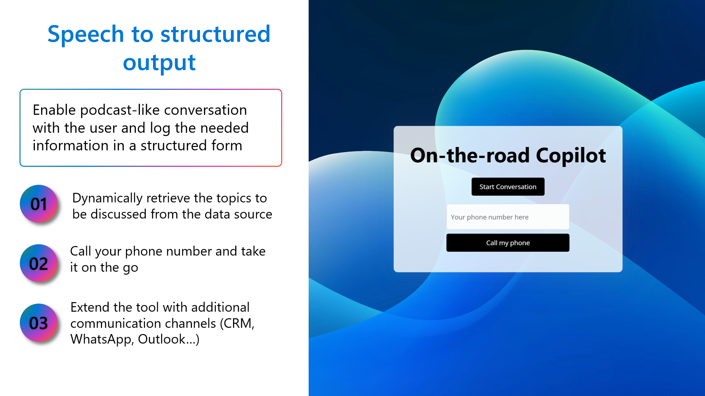
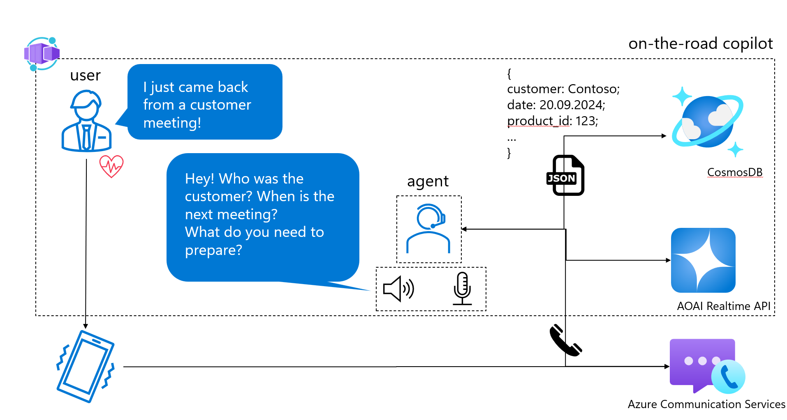

<h1 align="center">
  <br>
  <a href=""></a>
  <br>
  on-the-road copilot 🤖
  <br>
</h1>

<h4 align="center">A minimal speech-to-structured output app built with Azure OpenAI Realtime API.</h4>
</p>


## Problem we are addressing

- **Documentation overhead**: dealing with high volumes of documents and having at the same time not enough time in the day to maintain/fill them in;
- **Information loss**: if it takes a document or a form too long to be filled - information will get lost!


## Key features and technical details



- Backend: python
- Frontend: minimal JS, CSS/HTML

The app has minimal dependencies to allow for easy extension and integration with other communication channels and applications.

## Architecture



## How to set up the Azure environment

To run this application, you can provision the resources using Azure Developer CLI.

### Prerequisites

1. Install the [Azure Developer CLI](https://aka.ms/azure-dev-cli)
2. Install [Docker](https://docs.docker.com/get-docker/)
3. Install [Python 3.8+](https://www.python.org/downloads/)

### Steps

1. **Login to Azure Developer CLI**

    ```bash
    azd auth login
    ```

2. **Provision the resources**

    ```bash
    azd up
    ```

    During this step, you will be prompted to provide values for `location` and `aiResourceLocation`. The following values should work:

    - `location=northeurope`
    - `aiResourceLocation=swedencentral`

3. **Get and set the value for `AZURE_ENV_NAME`**

    ```bash
    source <(azd env get-values | grep AZURE_ENV_NAME)
    ```

4. **Build and deploy the Streamlit user interface**

    ```bash
    bash ./azd-hooks/deploy.sh app $AZURE_ENV_NAME
    ```

### Using the `azd-hooks/deploy.sh` script

The `azd-hooks/deploy.sh` script is used for deploying the application. It takes two arguments:

1. `SERVICE_NAME`: The name of the service to deploy.
2. `AZURE_ENV_NAME`: The name of the Azure environment.

Example usage:

```bash
bash ./azd-hooks/deploy.sh app $AZURE_ENV_NAME
```

### Configuration

The `azure.yaml` file contains configuration details for the Azure environment. Ensure that the configuration in this file matches your requirements.

### Environment Variables

The following environment variables are required for deployment:

- `AZURE_ENV_NAME`: The name of the Azure environment.
- `AZURE_LOCATION`: The location of the Azure resources.
- `AZURE_PRINCIPAL_ID`: The principal ID for Azure authentication.
- `OPENAI_CAPACITY`: The capacity for the OpenAI service.

Ensure these variables are set in your environment before deploying the application.

> **Note**
> If you do not provision a CosmosDB, you can still run the app using the local sample files. To replace the data source, substitute the CosmosDB module.

## Contributors

- [Masha Stroganova](https://www.linkedin.com/in/masha-stroganova/)
- [Dennis Zielke](https://www.linkedin.com/in/dennis-zielke-b24303123/)
- [Andreas Kopp](https://www.linkedin.com/in/andreas-kopp-1947183/)

## Related

[voice RAG](https://github.com/Azure-Samples/aisearch-openai-rag-audio) - RAG + Voice Using Azure AI Search and the GPT-4o Realtime API for Audio

## Disclaimer

This is an open-source repository and it does not have official support from Microsoft. Use at your own risk 😉

For production scenarios, questions and bugs please open a Github issue.
